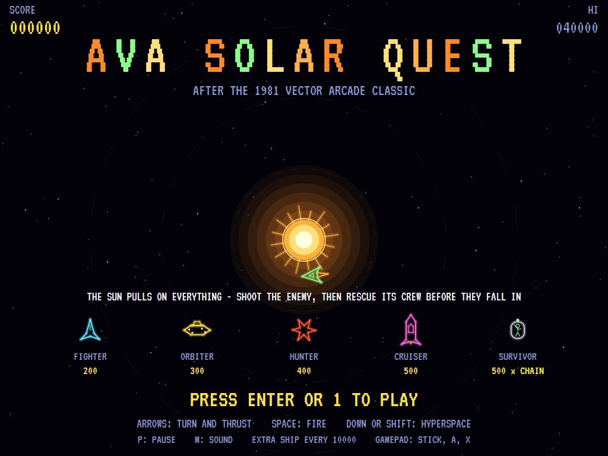
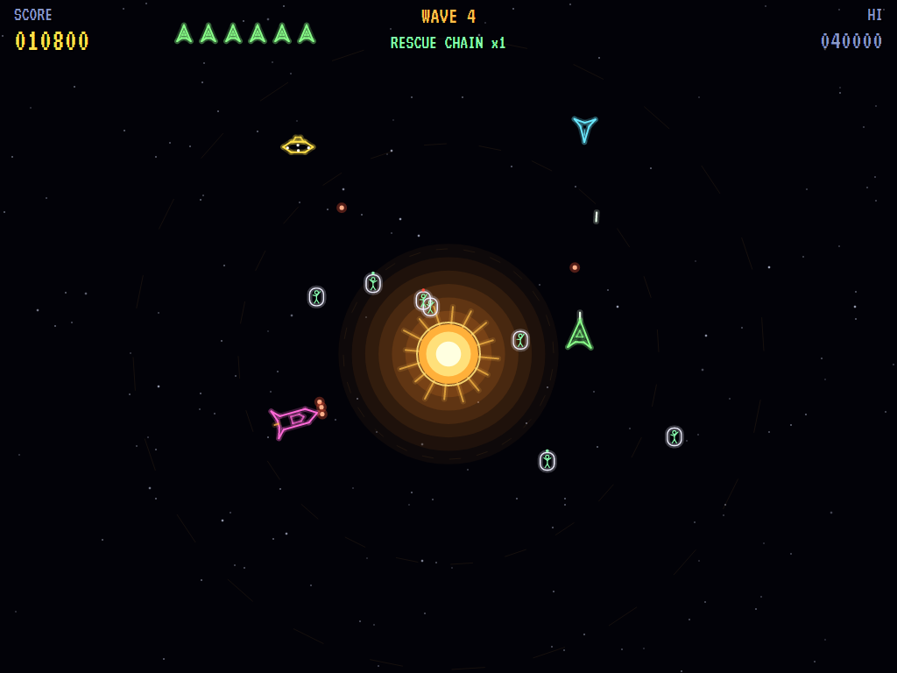
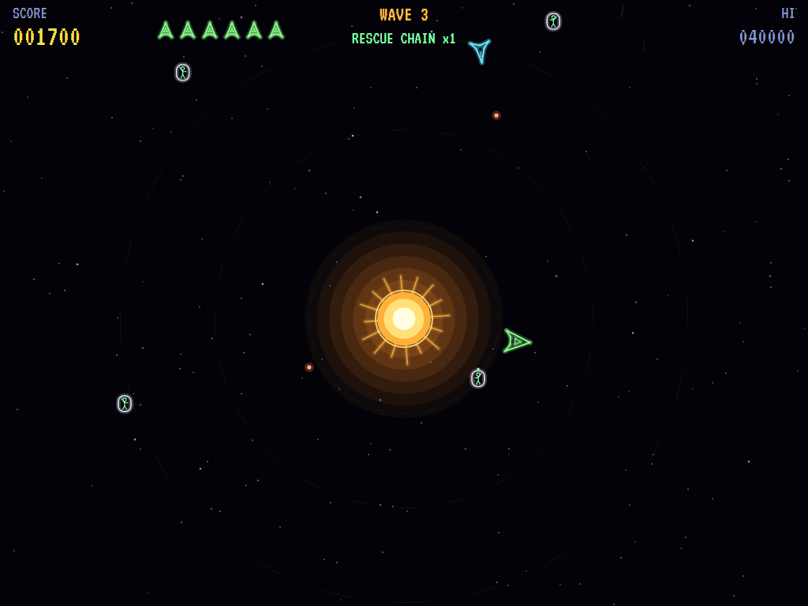
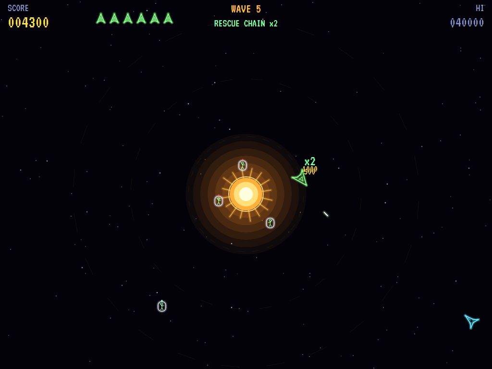
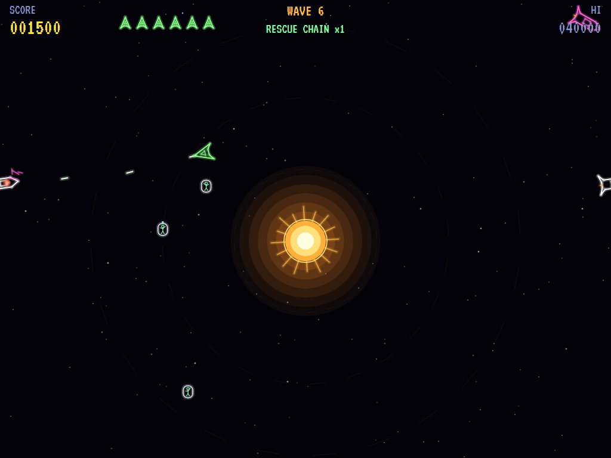
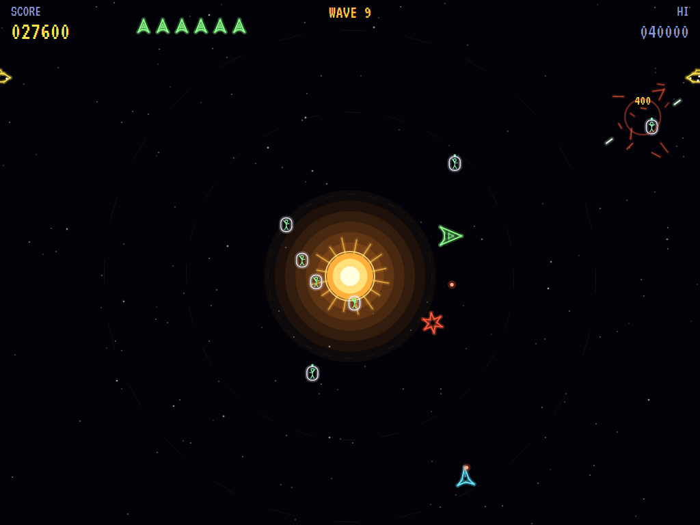
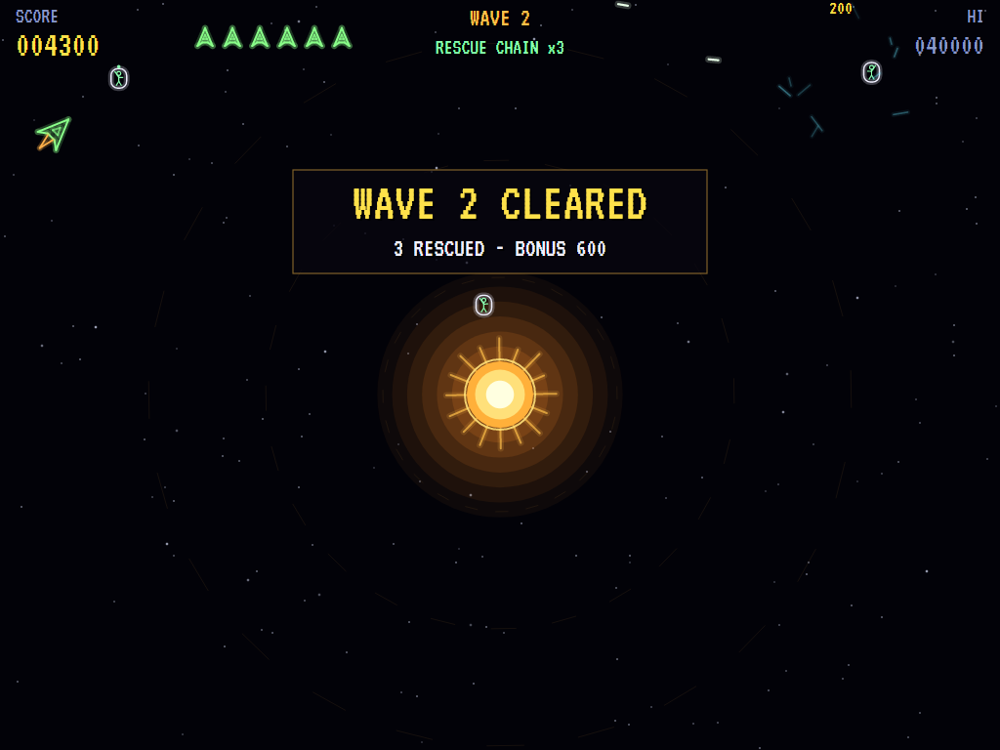
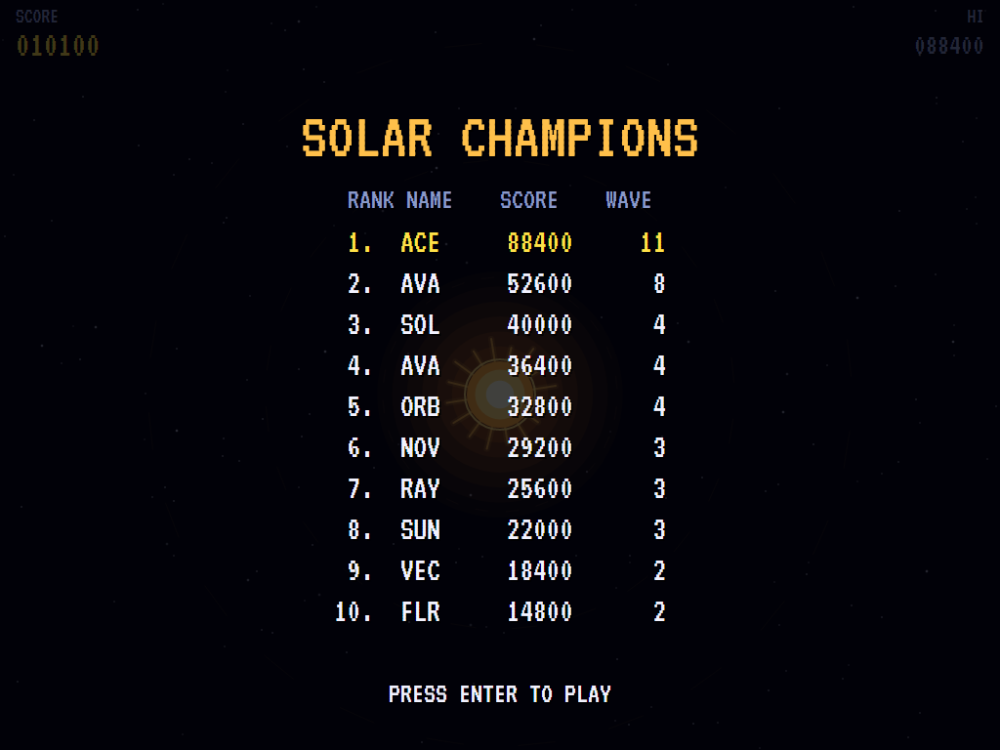

# AVA Solar Quest

[](https://github.com/Harlock123/AVASolarQuest/actions/workflows/build.yml)

A colour vector shooter in the style of Cinematronics' 1981 arcade game **Solar Quest**, built with .NET 10
and Avalonia UI. A sun burns in the middle of the screen, and its gravity pulls on everything: your ship, the
enemy, and even your shots. Fly round it, shoot down the enemy ships, then rescue their crews. They drift away
in escape pods, slowly falling towards the sun, and each one you pick up in a row is worth more than the last.

## Features

- **The sun** pulls on everything, harder the closer it is.
  - Fly into it and you burn; so does anything else.
  - Coast and you fall in, unless you keep going round it fast enough to stay in orbit.
  - Your shots bend round it.
  - A new ship starts in orbit below it.
- **The ship** turns, thrusts and coasts, with four shots at a time from the nose.
- **Hyperspace** jumps you somewhere else at random, stopped dead, never into the sun but maybe no safer.
  There's a short wait before you can jump again.
- **The enemy** comes in from the edges a few at a time:
  - **Fighters** (200) close in and circle you, firing when they face you.
  - **Orbiters** (300) circle the sun, firing as you pass.
  - **Hunters** (400) try to ram you.
  - **Cruisers** (500) take three hits and fire a spread of three.
  - They all steer clear of the sun, but they can still fall in.
- **Survivors:** a ship shot down leaves its crew (two for a cruiser) in escape pods, in an orbit that slowly
  decays.
  - Fly through a pod to pick them up: 500 points, times the length of your rescue chain, up to five.
  - Lose one to the sun, shoot one, or lose your ship, and the chain is broken.
  - A wave cleared pays a bonus for everyone rescued in it. Pods still drifting carry on into the next wave.
- **Each wave** brings more enemies, more kinds, more at a time, and better shots. There's an extra ship
  every 10000.
- **The attract mode** plays itself. The computer player:
  - looks ahead along its path and burns clear of the sun
  - leads its shots, but never fires through a survivor
  - goes after the pods when the fighting lets up
  - jumps into hyperspace when a shot can't be dodged
- **The sounds** are all synthesised: zaps, the hyperspace sweep, the rescue chime, the wail of a survivor
  lost to the sun, and the sun's own low, swelling hum.

## Screenshots

| The title | The fight | Survivors |
|:---------:|:---------:|:---------:|
|  |  |  |
| The enemy, and the survivors. | Round the sun. | Pods drifting in orbit. |

| A rescue | A cruiser | Hunters |
|:--------:|:---------:|:-------:|
|  |  |  |
| The chain going up. | Three hits, three shots. | Coming to ram. |

| A wave cleared | The high scores | |
|:--------------:|:---------------:|:-:|
|  |  | |
| The rescue bonus. | The solar champions. | |

The screenshots are made by the tests, which play the game in a real (headless) window; see
[Tests](#tests).

## Download and run

Ready-to-run builds for Windows, macOS and Linux, on both Intel/AMD and ARM, are on the
[Releases page](https://github.com/Harlock123/AVASolarQuest/releases/tag/latest). **Latest build** is
rebuilt on every push to `main`. Each download is one self-contained executable: no .NET install is
needed.

| Platform | Archive |
|---|---|
| Windows | `AVASolarQuest-win-x64.zip`, `AVASolarQuest-win-x86.zip`, `AVASolarQuest-win-arm64.zip` |
| macOS | `AVASolarQuest-osx-arm64.tar.gz` (Apple silicon), `AVASolarQuest-osx-x64.tar.gz` (Intel) |
| Linux | `AVASolarQuest-linux-x64.tar.gz`, `AVASolarQuest-linux-arm64.tar.gz`, `AVASolarQuest-linux-arm.tar.gz` |

```bash
tar -xzf AVASolarQuest-linux-x64.tar.gz     # or linux-arm64, linux-arm, osx-arm64, osx-x64
./AVASolarQuest
```

On Windows, unzip and run `AVASolarQuest.exe`. On macOS, if Gatekeeper refuses to open it, run
`xattr -d com.apple.quarantine AVASolarQuest` once. Run with `--no-audio` for silence.

**Sound** comes through OpenAL Soft, built in for every platform. In a virtual machine the game
detects it and uses a larger audio buffer, so the sound doesn't break up.

**Gamepads** use SDL2, which is bundled for Windows, macOS and Intel/AMD Linux. ARM Linux builds need it
installed; without it the keyboard still works:

```bash
sudo apt install libsdl2-dev            # Debian / Ubuntu / Raspberry Pi OS
sudo pacman -S --needed sdl2-compat     # Arch / Omarchy
```

## Controls

| Action | Keyboard | Gamepad |
|---|---|---|
| Start | Enter or 1 | Start |
| Turn | Left / Right (or A / D) | Left stick / D-pad |
| Thrust | Up (or W) | Up, B or left trigger |
| Fire | Space, Z or Ctrl | A or right trigger |
| Hyperspace | Down, S, X or Shift | Down, X or Y |
| Pause | P or Esc | Start |
| Quit (while paused) | Esc | Back |
| Sound on/off | M | |
| Screenshot | Ctrl+S (to your Pictures folder) | |

On the high-score table, type your initials, or use up/down and Space, then Enter.

## Tests

```bash
dotnet test AVASolarQuest.slnx
```

The engine has no UI and runs in fixed 60 Hz steps, so it plays the same at any frame rate, and a seed
always plays the same game. The tests check:

- **The sun:**
  - its pull, harder closer in, and space wrapping
  - a circular orbit holding
  - a ship left alone falling in and burning
  - the new ship starting in orbit
- **The ship:**
  - turning and thrust
  - four shots from the nose, bending towards the sun
  - hyperspace (never into the sun, and not again straight away)
- **The enemy:**
  - each kind's hits, points and crew
  - enemies firing when they face the ship, and a shot costing a life
  - orbiters circling the sun, and hunters ramming
  - more enemies of more kinds each wave
- **The survivors:**
  - drifting round the sun and falling in
  - the rescue chain, and shooting a survivor breaking it
  - the wave bonus, and pods carrying on into the next wave
- **The machine:** extra ships, the last ship, initials, the title and demonstration, starting a game, the
  computer player clearing a wave and rescuing someone, the same game from the same seed, and pausing

The screenshot tests draw the real screen in a headless window. To refresh the README's pictures:

```bash
SOLARQUEST_SHOTS=$PWD/Images dotnet test tests/AVASolarQuest.Tests --filter ScreenshotTests
```

To see how the computer player gets on, wave by wave, with how the survivors fared (for tuning; `1` for the
pilot, `lazy` for one that just spins and fires):

```bash
SOLARQUEST_PROBE=1 dotnet test tests/AVASolarQuest.Tests --filter PilotProbe --logger "console;verbosity=detailed"
```

## Building

```bash
dotnet build AVASolarQuest.slnx
dotnet run --project src/AVASolarQuest
```

Needs the .NET 10 SDK. The sounds are made by `tools/make_sounds.py` (standard-library Python):
`python3 tools/make_sounds.py` rewrites `src/AVASolarQuest/Sounds`.

## Project structure

```
AVASolarQuest/
├── AVASolarQuest.slnx
├── src/AVASolarQuest/
│   ├── Engine/
│   │   ├── GameEngine.cs        # States, the title and demo cycle, the sun's hum
│   │   ├── GameEngine.Play.cs   # The ship, gravity and hyperspace; the enemy; the survivors and the
│   │   │                        # rescue chain; waves and scoring
│   │   ├── ShipPilot.cs         # The computer player, for the demonstration (and the tests)
│   │   ├── Entities.cs          # Wrapping space and the sun's pull; the ship, the enemy and the pods
│   │   ├── HighScoreTable.cs, InitialsEntry.cs
│   │   ├── InputHandler.cs, ControllerManager.cs  # Keys and an SDL2 gamepad
│   │   └── SoundManager.cs      # Effects and the tunes through OpenAL
│   ├── Audio/                   # The OpenAL engine (from the author's AVABand)
│   ├── Views/                   # The vector drawing: the sun, the ships, the pods and the screens
│   └── Sounds/                  # The synthesised effects and tunes
├── tests/AVASolarQuest.Tests/   # Gameplay, screenshot and probe tests
├── tools/make_sounds.py
└── Images/                      # Screenshots
```

## About and licence

AVA Solar Quest © 2026 Lonnie Watson, under the [MIT License](LICENSE).

*Solar Quest* © 1981 Cinematronics; the name belongs to its current owner. AVA Solar Quest is an independent,
unofficial game in its style. Its sun, ships, enemies and survivors, its graphics, sounds, tunes and code are
its own; nothing is taken from the arcade machine's program, graphics, sound or music. It is not affiliated
with or endorsed by any rights holder.
